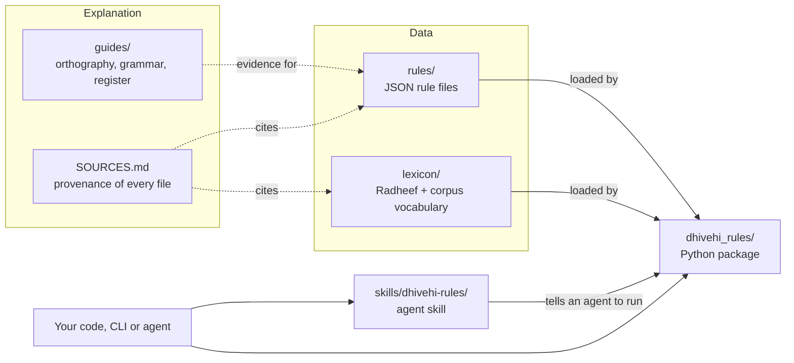
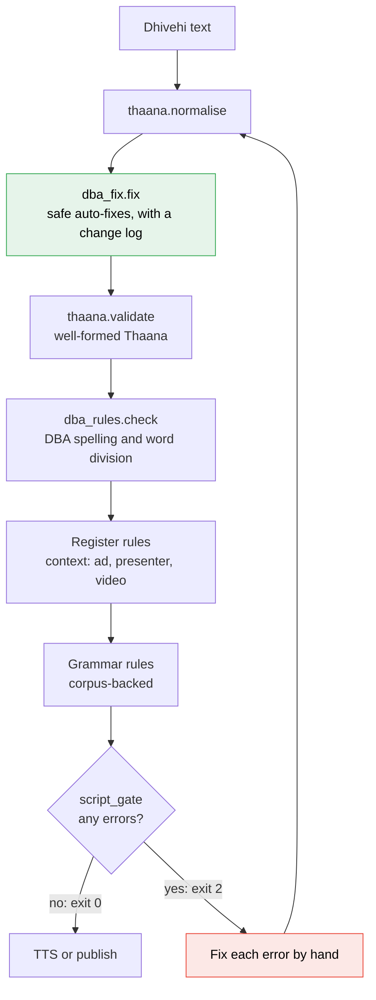

<div align="center">

# dhivehi-rules

### ދިވެހި ލިޔުމުގެ ގަވާއިދު

**The Dhivehi Academy's writing standards as data, plus a small checker that applies them.**

[](LICENSE)
[](pyproject.toml)
[](pyproject.toml)

</div>

This repository describes how Dhivehi is written, checked and read aloud. It has four parts:

- the Dhivehi Academy (DBA) standards as machine-readable JSON: dotted letters (thikijehi),
  word division, official month names and romanisation
- the Radheef dictionary and a corpus vocabulary of about 506k word forms
- guides that explain each rule and the evidence for it
- a Python package with no dependencies that normalises, validates, checks, auto-fixes and
  romanises Thaana, and gates text before it is sent to text-to-speech or published

---

## Contents

- [Repository map](#repository-map)
- [The checking pipeline](#the-checking-pipeline)
- [The rules at a glance](#the-rules-at-a-glance)
  - [Dotted letters (thikijehi)](#dotted-letters-thikijehi)
  - [Word division (2024)](#word-division-2024)
  - [Grammar](#grammar)
  - [Register for an audience](#register-for-an-audience)
  - [Months and weekdays](#months-and-weekdays)
  - [Numbers](#numbers)
  - [Romanisation (1977)](#romanisation-1977)
  - [Auto-fix vs flag only](#auto-fix-vs-flag-only)
- [Quick start](#quick-start)
- [For AI agents](#for-ai-agents)
- [Data files](#data-files)
- [Sources](#sources)
- [Contributing](#contributing)
- [License](#license)

---

## Repository map



| Path | What it holds |
|---|---|
| [`rules/`](rules) | The rules as JSON. Every file has `_source` / `_about` fields that say where it comes from |
| [`lexicon/`](lexicon) | The Radheef dictionary, its headword list and label maps, and corpus word-form counts |
| [`guides/`](guides) | The rules written out in prose, with the evidence: [orthography](guides/orthography.md), [grammar](guides/grammar.md), [spoken register](guides/spoken_register.md) |
| [`dhivehi_rules/`](dhivehi_rules) | The Python package (standard library only) |
| [`skills/dhivehi-rules/`](skills/dhivehi-rules/SKILL.md) | An agent skill: how an AI agent should write and check Dhivehi |
| [`SOURCES.md`](SOURCES.md) | Where every file comes from |

<details>
<summary><b>Package modules</b></summary>

| Module | Entry point | Does |
|---|---|---|
| `thaana.py` | `normalise()`, `validate()` | Checks that Thaana is well formed: every consonant has a fili or sukun, with no orphan or doubled marks |
| `dba_rules.py` | `check()` | DBA spelling and word division, plus register and grammar when a context is given |
| `dba_fix.py` | `fix()` | Applies only the corrections that are safe to make automatically, and logs each change |
| `script_gate.py` | `check_script()`, `gate()`, `gate_lines()` | Runs every check and blocks on errors. Text must pass it before TTS or publishing |
| `thaana_latin.py` | `romanise()` | Official 1977 Latin romanisation |

</details>

---

## The checking pipeline



`dba_fix` is the only step that changes text, and it applies only corrections that were
audited on corpus samples. Every other step reports. Warnings, which have rule ids starting
with `~`, are allowed through the gate because a person needs to judge them. Errors block.

---

## The rules at a glance

Every example below comes from the JSON in [`rules/`](rules) or the [guides](guides).

### Dotted letters (thikijehi)

The 2024 DBA rules keep thikijehi to a minimum. **Write the plain letter unless the word is in
a protected category.** Source: [`rules/dba_thikijehi_rules.json`](rules/dba_thikijehi_rules.json),
[guide §2](guides/orthography.md#2-dotted-letters-the-default-is-plain).

**Always reduce** (rule 5, substitution table)

| Dotted | ޘ | ޛ | ޟ | ޡ | ޥ | ޜ |
|---|:-:|:-:|:-:|:-:|:-:|:-:|
| **Write** | ސ | ޒ | ޒ | ޒ | ވ | ޒ |

**Reduce in ordinary words** (rule 9: Radheef prefers the plain form)

| Dotted | Plain | ✅ Write | ❌ Not |
|:-:|:-:|---|---|
| ޤ | ގ | ގައުމު | ޤައުމު |
| ޞ | ސ | އުސޫލު, އަސްލު | އުޞޫލު, އަޞްލު |
| ޙ | ހ | ހަގީގަތް | ޙަޤީޤަތް |
| ޢ | އ | އިއްޒަތްތެރި | ޢިއްޒަތްތެރި |
| ޠ | ތ | — | — |

More plain forms from the book: ގަވާއިދު, ހާސިލު, މަގުސަދު, ތަހުގީގު.

**Never drop** (rule 3: these are now Dhivehi sounds)

| Letter | ޚ | ޣ | ޝ |
|---|:-:|:-:|:-:|
| **Examples** | ޚަބަރު, ޚިޔާލު | މަޣުރިބު | މަޝްހޫރު |

<details>
<summary><b>Keep the dots</b> (rules 1, 4, 6, 10): homographs, Hijri months, names, titles, religious text</summary>

| Category | Examples |
|---|---|
| Homographs, where the dots decide the meaning | ޢަމަލު "deed" vs އަމަލު "intoxicant" · ޚަބަރު "news" vs ހަބަރު · ވަޞީލަތް vs ވަސީލަތް · ޤާޟީ vs ޣާޒީ |
| Derived forms of homographs | ޢަމަލީ, ޢަމަލުކުރުން |
| Curated homograph list (`homographs_keep_dots`) | ޢަމަލު, ޚަބަރު, ޤާޟީ, ޣާޒީ, ވަޞީލަތް, ތަޙުލީލު, ނަޞްރު, ޙޫރުން, މުޤައްރަރު, ނާޤާބިލު |
| Hijri month names | ޝަޢުބާން, ރަމަޟާން, ޛުލްޤަޢިދާ, މުޙައްރަމް |
| Arabic personal names in official text | ޢަބްދުއްރަޙުމާން, ޤާސިމް, ނާޡިމް, ޢަޒީޒް |
| Arabic titles and positions | ޤާޟީ, ޢާމިލު, މުޙާމީ |
| Names of Allah | އައްރަޙުމާން, އައްރަޙީމް |
| Religious phrases, exactly as written | ޞައްލަﷲ ޢަލައިހި ޥަސައްލަމް |
| Arabic titles before names | އަލްފާޟިލް, އަލްފާޟިލާ |
| The name of Allah, always as the ligature | ﷲ, މާތްﷲ |

Personal names whose dotted spelling is kept are listed in
[`rules/protected_names.json`](rules/protected_names.json) (390 forms).

</details>

### Word division (2024)

From ލަފުޒު ވަކިކޮށް ލިޔުމުގެ ގަވާއިދު (2024), which supersedes the 2013 edition. Each rule id
names its section of the book. Source: [guide §3](guides/orthography.md#3-word-division-2024).

| Rule id | Section | Rule | ✅ Correct | ❌ Wrong |
|---|---|---|---|---|
| `5n_ordinal_split` | §5(ނ) | ވަނަ is joined to the number before it | 2021ވަނަ | 2021 ވަނަ |
| `6sh_particle_joined` | §6(ށ) | These particles stand apart: ވެސް, ނަމަވެސް, ފަދަ, ޓަކައި, ފިޔަވައި, މެނުވީ, ކަހަލަ | އަހަރު ވެސް | އަހަރުވެސް |
| `6n_particle_split` | §6(ނ),(ރ) | Plural and question particles are joined: ތައް, ތަކެއް, ތަކުގެ, ތަކަށް, ތަކުން, ހެއްޔެވެ, ތޯ | ދޮރުތައް | ދޮރު ތައް |
| `6n_case_suffix` | §6(ނ) | A case suffix is joined to its noun (fixer only) | ގާނޫނުގެ | — |
| `6b_negation_split` | §6(ބ) | The negation prefixes ނު and ބަދު are joined | — | — |
| `1k_reduplication_split` | §1(ކ), §2(ނ), §3(ށ) | A word repeated for plurality or intensity is written as one word when the joined form is attested | — | — |
| `7h_space_before_stop` | §7(ހ) | No space before a full stop | ދިޔައީމެވެ. | ދިޔައީމެވެ . |
| `7h_no_space_after_stop` | §7(ހ) | One space after a full stop | | |
| `7n_padded_bracket` | §7(ނ) | No space inside brackets | | |
| `7b_spaced_slash` | §7(ބ) | No space around a slash between Thaana words | | |

Ambiguous forms are left alone on purpose. ގެ can be the genitive or "house", ކަން the
"-ness" suffix or "matter", and އެއް the indefinite or the numeral "one". Abbreviations written
with stops, such as އެމް.ޑީ.ޕީ, are correct.

### Grammar

Corpus-backed rules for the errors that generated Dhivehi tends to make. Source:
[`rules/grammar_rules.json`](rules/grammar_rules.json), with the evidence in
[`guides/grammar.md`](guides/grammar.md). They run with `--grammar`, with any `--context`, and
always in the gate.

| Rule id | What it checks | ❌ Wrong | ✅ Right |
|---|---|---|---|
| `gr_exist_agreement` | The existential verb agrees with the noun: ހުރި for physical things and most plurals, އޮތް for abstract or lying things, ތިބި for people. The table covers 79 nouns and 25 human plurals | ސުވާލެއް ހުރި ނަމަ<br>ކުދިން ހުރި | ސުވާލެއް އޮތް ނަމަ<br>ކުދިން ތިބި |
| `gr_honorific_first_person` | An honorific verb never takes the first-person ending -ނަން | ކޮށްދެއްވާނަން<br>…ކުރައްވާނަން<br>ބައްލަވާނަން | ކޮށްދޭނަން<br>…ކުރާނަން<br>ބަލާނަން |
| `gr_numeral_plural` | A noun stays singular after a numeral. ކަންތައް is the exception | ދެ ކުލަތައް | ދެ ކުލަ |
| `gr_plural_uncountable` | Abstract -ތެރިކަން nouns and mass nouns such as ލޯބި, ޝުކުރު, ހޫނު, ހިލޭ, ކޮލިޓީ take no plural | ބޭނުންތެރިކަންތައް<br>ލޯބިތައް | ބޭނުންތެރިކަން<br>ލޯބި |
| `gr_sentence_initial_nama` | "However" at the start of a sentence is ނަމަވެސް. Bare ނަމަ means "if" | ނަމަ، … | ނަމަވެސް، … |
| `gr_nama_after_finite` | ނަމަ never follows the sentence-final -އެވެ form | ހުރެއެވެ ނަމަ | ހުރި ނަމަ |

<details>
<summary>How <code>gr_exist_agreement</code> depends on number: a sample of the table</summary>

| Noun | Form | Takes | Corpus count before the verb (ހުރި / އޮތް / ތިބި) |
|---|---|:-:|---|
| ސުވާލު | -އެއް | **އޮތް** | 30 / 367 / 0 |
| ސުވާލު | -ތައް | **ހުރި** | 158 / 29 / 0 |
| ފުރުސަތު | bare | **އޮތް** | 26 / 10,978 / 0 |
| ނިޒާމު | bare | **އޮތް** | 102 / 1,319 / 0 |
| ތަޖުރިބާ | bare | **ހުރި** | 2,383 / 44 / 25 |
| ފިހާރަ | bare | **ހުރި** | 927 / 6 / 0 |
| ކުދިން | -ތައް | **ތިބި** | 0 / 4 / 122 |

The full table is in [`guides/grammar.md`](guides/grammar.md).

</details>

### Register for an audience

Word choice for speech addressed to viewers. These rules run only when a context is given:
`ad`, `presenter` or `video`. Source: [`rules/register_rules.json`](rules/register_rules.json),
with the evidence in [`guides/spoken_register.md`](guides/spoken_register.md).
In the checker's output, warnings are shown with a leading `~`.

| Rule id | Level | ❌ Avoid | ✅ Use | Why |
|---|---|---|---|---|
| `reg_address_tiyabaimeehun` | error | ތިޔަބައިމީހުން | ތިޔަބޭފުޅުން | Scripture-translation register |
| `reg_address_kalé` | error | ކަލޭ, ކަލޭމެން | ތިޔަބޭފުޅުން | Intimate or rude |
| `reg_address_tibaa` | warn | ތިބާ | ތިޔަބޭފުޅުން | The generic "you" of slogans and essays |
| `reg_first_person_aharen` | error | އަހަރެން, އަހަންނަށް, އަހަންނާ | އަޅުގަނޑު, އަޅުގަނޑަށް, އަޅުގަނޑާ | The private, written-narrative "I" |
| `reg_first_person_aharemen` | error | އަހަރެމެން | އަޅުގަނޑުމެން | The plural of the same "I" |
| `reg_first_person_thimanna` | warn | ތިމަންނަ | އަޅުގަނޑު | The "I" of official letters and oaths |
| `reg_plain_imperative` | warn | ގުޅާ, ބަލާ, ބަލާލާ, ގަންނާ | ގުޅުއްވާ, ބައްލަވާ, ބައްލަވާލައްވާ, ގަންނަވާ | Honorific forms when asking an audience |
| `reg_calque_delivery_free` | error | ޑެލިވަރީ ހިލޭ, ޑެލިވަރީ ފްރީ | ހިލޭ ޑެލިވަރީ | English word order |
| `reg_calque_whatsapp_verb` | warn | ވަޓްސްއެޕް ކުރައްވާ | ވަޓްސްއެޕް މެދުވެރިކޮށް މެސެޖުކުރައްވާ | English verb |
| `reg_calque_good_day` | warn | ހެޔޮ ދުވަހެއް | ބާއްޖަވެރި ދުވަހަކަށް އެދެން | A calque of "have a good day" |
| `reg_calque_thanks_order` | warn | ޝުކުރިއްޔާ ބެއްލެވީތީ | ބެއްލެވީތީ ޝުކުރިއްޔާ | In Dhivehi the reason comes first |
| `reg_unattested_coinage` | warn | ފެންފައިޕު, މަލަ ނާރާ | The product name, or ބާވަތް | Coinages with no attestation |

### Months and weekdays

Official forms from the Dhivehi Academy's 2013 announcement in the Government Gazette
([iulaan/4791](https://www.gazette.gov.mv/iulaan/4791)). Source:
[`rules/calendar.json`](rules/calendar.json). Hijri months keep their dots.

<details>
<summary><b>Months</b>: Gregorian and Hijri, official forms and common non-standard variants</summary>

| # | Gregorian | Official | ❌ Non-standard (recognised, never written) | Hijri (official) |
|--:|---|---|---|---|
| 1 | January | ޖަނަވަރީ | | މުޙައްރަމް |
| 2 | February | ފެބުރުވަރީ | ފެބްރުއަރީ | ޞަފަރު |
| 3 | March | މާރިޗު | | ރަބީޢުލްއައްވަލް |
| 4 | April | އެޕްރީލް | އޭޕްރީލް | ރަބީޢުލްއާޚިރު |
| 5 | May | މޭ | މެއި | ޖުމާދަލްއޫލާ |
| 6 | June | ޖޫން | | ޖުމާދަލްއާޚިރާ |
| 7 | July | ޖުލައި | | ރަޖަބު |
| 8 | August | އޮގަސްޓު | އޯގަސްޓު | ޝަޢުބާން |
| 9 | September | ސެޕްޓެންބަރު | ސެޕްޓެމްބަރު, ސެޕްޓެމްބަރ | ރަމަޟާން |
| 10 | October | އޮކްޓޫބަރު | | ޝައްވާލް |
| 11 | November | ނޮވެންބަރު | ނޮވެމްބަރު | ޛުލްޤަޢިދާ |
| 12 | December | ޑިސެންބަރު | ޑިސެމްބަރު | ޛުލްޙިއްޖާ |

Date format in official letters: `<day> <month> <year>`, for example 12 އޮގަސްޓު 2026.

</details>

| Sun | Mon | Tue | Wed | Thu | Fri | Sat |
|:-:|:-:|:-:|:-:|:-:|:-:|:-:|
| އާދީއްތަ | ހޯމަ | އަންގާރަ | ބުދަ | ބުރާސްފަތި | ހުކުރު | ހޮނިހިރު |

### Numbers

Each number has two forms. The **standalone** form ends a phrase. The **pre-noun** form comes
before a noun, ވަނަ or ހާސް. Numbers 11 to 29 have a single form. Source:
[`rules/numbers.json`](rules/numbers.json), which also covers 0–99, hundreds, thousands and
larger scales.

| n | Standalone | Pre-noun |
|--:|---|---|
| 0 | ސުމެއް | ސުމެއް |
| 1 | އެކެއް | އެއް |
| 2 | ދޭއް | ދެ |
| 3 | ތިނެއް | ތިން |
| 4 | ހަތަރެއް | ހަތަރު |
| 5 | ފަހެއް | ފަސް |
| 6 | ހައެއް | ހަ |
| 7 | ހަތެއް | ހަތް |
| 8 | އަށެއް | އަށް |
| 9 | ނުވައެއް | ނުވަ |
| 10 | ދިހައެއް | ދިހަ |

<details>
<summary>Tens, hundreds and thousands</summary>

| 20 | 30 | 40 | 50 | 60 | 70 | 80 | 90 |
|:-:|:-:|:-:|:-:|:-:|:-:|:-:|:-:|
| ވިހި | ތިރީސް | ސާޅީސް | ފަންސާސް | ފަސްދޮޅަސް | ހަތްދިހަ | އައްޑިހަ | ނުވަދިހަ |

| 100 | 200 | 300 | 1,000 | 2,000 | 10,000 |
|:-:|:-:|:-:|:-:|:-:|:-:|
| ސަތޭކަ | ދުވިސައްތަ | ތިން ސަތޭކަ | އެއްހާސް | ދެހާސް | ދިހައެއް ހާސް |

Scales: މިލިއަން, ބިލިއަން, ޓްރިލިއަން.

</details>

### Romanisation (1977)

The official rules of 23 May 1977, implemented in `thaana_latin.romanise`. It reproduces all
68 examples in the booklet. Source: [guide §5](guides/orthography.md#5-romanisation-23-may-1977).

<details>
<summary><b>Consonants</b> (§1) and <b>Arabic letters</b> (§2)</summary>

| Thaana | Latin | Thaana | Latin | Thaana | Latin | Thaana | Latin |
|:-:|:-:|:-:|:-:|:-:|:-:|:-:|:-:|
| ހ | h | ށ | sh | ނ | n | ރ | r |
| ބ | b | ޅ | lh | ކ | k | ވ | v |
| މ | m | ފ | f | ދ | dh | ތ | th |
| ލ | l | ގ | g | ޏ | gn | ސ | s |
| ޑ | d | ޒ | z | ޓ | t | ޔ | y |
| ޕ | p | ޖ | j | ޗ | ch | | |

| Thaana | Latin | Thaana | Latin | Thaana | Latin | Thaana | Latin |
|:-:|:-:|:-:|:-:|:-:|:-:|:-:|:-:|
| ޞ | s' | ޟ | l' | ޠ | t' | ޡ | z' |
| ޥ | w | ޘ | th' | ޙ | h' | ޚ | kh |
| ޛ | dh' | ޣ | gh | ޤ | q | ޝ | sh |

ޢ is written as its vowel with an apostrophe, as in a'mal.

</details>

**Vowels** (§3). އ followed by a vowel is written as the vowel alone.

| ަ | ާ | ި | ީ | ު | ޫ | ެ | ޭ | ޮ | ޯ |
|:-:|:-:|:-:|:-:|:-:|:-:|:-:|:-:|:-:|:-:|
| a | aa | i | ee | u | oo | e | ey | o | oa |

**Sukun** (§4). A final އް is h (meeheh), ން is n (fen), ށް is iy (foiy) and ސް is s (gas). Before a
consonant, އް doubles that consonant (bappa), and ން before މ is m (mamma). A bare ނ before a
consonant is n' (kan'di, an'bu).

### Auto-fix vs flag only

A fixer that changes correct text does more harm than having no fixer. Each auto-fix rule was
audited on random corpus samples before it was allowed to change text. Source:
[guide §4](guides/orthography.md#4-auto-fix-versus-flag-only).

| Rule | `dba_fix` auto-fixes? | Audit / reason |
|---|:-:|---|
| §6(ށ) particle glued to the word before it | ✅ | 30/30, then 40/40 |
| §5(ނ) ordinal written apart | ✅ | 30/30, then 40/40 |
| §6(ނ) plural or question particle written apart | ✅ | about 29/30, then 40/40 |
| §6(ނ) case suffix written apart | ✅ | Only when the joined form occurs at least 20 times in the corpus |
| §7 spacing around stops and brackets, in Thaana only | ✅ | 25/25 |
| Thikijehi reduction, with evidence | ✅ | 50/50. Only when Radheef or the book has the plain form, or the plain form is in real use |
| §1(ކ) reduplication | ❌ flag | about 19/30 in audit: typos and Hindi titles look the same |
| §6(ބ) negation | ❌ flag | ނޫ is "blue" and ބޭ is "Bay" in place names |
| Thikijehi below the evidence threshold | ❌ flag | Soft warning |
| Register and grammar rules | ❌ flag | A suggestion is given, but a person applies it |

The fixer never touches ޚ ޣ ޝ, homographs and their derived forms, Hijri months, anything
containing ﷲ, protected personal names, or dotted words next to a title or a protected name.
Running it twice changes nothing the second time.

---

## Quick start

```bash
git clone https://github.com/alee-ibrahim/dhivehi-rules
pip install -e dhivehi-rules
```

> [!IMPORTANT]
> **Install in editable mode (`-e`).** The package reads `rules/` and `lexicon/` from the
> repository checkout, relative to the package directory, so it has to run from the clone.

The install adds three commands: `dhivehi-script-gate`, `dhivehi-dba-check` and
`dhivehi-dba-fix`. Each is the same as the `python -m` form shown below.

### Command line

**Gate a script before TTS or publishing.** Exit codes: 0 means clean or warnings only, 2 means
errors, 1 means bad usage.

```console
$ python -m dhivehi_rules.script_gate --context ad "ސުވާލެއް ހުރި ނަމަ، ގުޅުއްވާ."
[script_gate text] ސުވާލެއް ހުރި ނަމަ، ގުޅުއްވާ.
    ERROR gr_exist_agreement: «ސުވާލެއް ހުރި» -> «ސުވާލެއް އޮތް»   [ސުވާލު (indefinite singular) takes އޮތް: corpus އޮތް 367 vs ހުރި 30 of 397]

!!!!!!!!!!!!!!!!!!!!!!!!!!!!!!!!!!!!!!!!!!!!!!!!!!!!!!!!!!!!!!!!!!!!!!!!!!!!!!
!! script_gate: BLOCKED. 1 of 1 line(s) have Dhivehi errors: text. Nothing was sent to TTS.
!!!!!!!!!!!!!!!!!!!!!!!!!!!!!!!!!!!!!!!!!!!!!!!!!!!!!!!!!!!!!!!!!!!!!!!!!!!!!!

Fix each ERROR above (the suggested form follows ->) and run again.
Override only if a native speaker has checked the line: re-run with --force.

$ python -m dhivehi_rules.script_gate --context ad "ސުވާލެއް އޮތް ނަމަ، ގުޅުއްވާ."
[script_gate] 1 line(s) passed (context=ad).
```

`--file` accepts a JSON object (`{key: line}`), a JSON list, or a text or Markdown file, in which
case every line containing Thaana is checked. `--force` lets errors through, prints a banner
and writes a record to `logs/gate_overrides.log`.

**Check DBA spelling and word division:**

```console
$ python -m dhivehi_rules.dba_rules "އަހަރެންވެސް 14 ވަނަ ދުވަހު ދިޔައީމެވެ ."
5n_ordinal_split             14 ވަނަ
7h_space_before_stop          .
6sh_particle_joined          އަހަރެންވެސް
```

**Add register and grammar** with `--context ad|presenter|video`, or only grammar with `--grammar`:

```console
$ python -m dhivehi_rules.dba_rules --context presenter "އަހަރެން ތިބާއަށް ޑެލިވަރީ ހިލޭ ކޮށްދޭނަން"
~reg_address_tibaa           ތިބާއަށް  ->  ތިޔަބޭފުޅުން
reg_first_person_aharen      އަހަރެން  ->  އަޅުގަނޑު
reg_calque_delivery_free     ޑެލިވަރީ ހިލޭ  ->  ހިލޭ ޑެލިވަރީ

$ python -m dhivehi_rules.dba_rules --grammar "ސުވާލެއް ހުރި ނަމަ"
gr_exist_agreement           ސުވާލެއް ހުރި  ->  ސުވާލެއް އޮތް
```

**Apply the safe fixes:**

```console
$ python -m dhivehi_rules.dba_fix "ޢިއްޒަތްތެރި ރައީސް 2021 ވަނަ އަހަރުވެސް"
އިއްޒަތްތެރި ރައީސް 2021ވަނަ އަހަރު ވެސް
  5n_ordinal     '2021 ވަނަ' -> '2021ވަނަ'
  thikijehi      'ޢިއްޒަތްތެރި' -> 'އިއްޒަތްތެރި'
  6sh_particle   'އަހަރުވެސް' -> 'އަހަރު ވެސް'
```

**Romanise:**

```console
$ python -m dhivehi_rules.thaana_latin "ދިވެހި ލިޔުމުގެ ގަވާއިދު"
Dhivehi liyumuge gavaaidhu

$ python -m dhivehi_rules.thaana_latin --test
68/68 booklet examples reproduced
```

### Python API

```python
from dhivehi_rules import thaana, dba_rules, dba_fix, thaana_latin
from dhivehi_rules.script_gate import check_script, gate, gate_lines

text = thaana.normalise("ޢިއްޒަތްތެރި ރައީސް 2021 ވަނަ އަހަރުވެސް")
fixed, changes = dba_fix.fix(text)
# fixed   -> 'އިއްޒަތްތެރި ރައީސް 2021ވަނަ އަހަރު ވެސް'
# changes -> [('5n_ordinal', '2021 ވަނަ', '2021ވަނަ'),
#             ('thikijehi', 'ޢިއްޒަތްތެރި', 'އިއްޒަތްތެރި'),
#             ('6sh_particle', 'އަހަރުވެސް', 'އަހަރު ވެސް')]

check_script(fixed, "video")          # -> (True, 'clean'); never raises
thaana_latin.romanise(fixed)          # -> 'Izzaththeri raees 2021vana aharu ves'

dba_rules.check("ސުވާލެއް ހުރި ނަމަ", "presenter")
# -> [Hit(rule='gr_exist_agreement', span='ސުވާލެއް ހުރި', fix='ސުވާލެއް އޮތް', why='...')]

thaana.validate(text).orthography_errors
gate(fixed, label="intro", context="ad")               # SystemExit(2) on errors
gate_lines({"h": fixed}, context="ad")                 # many lines, one report
```

The JSON files can be read directly from any language.

---

## For AI agents

[`skills/dhivehi-rules/SKILL.md`](skills/dhivehi-rules/SKILL.md) is an agent skill in the
Agent Skills format (a `SKILL.md` with YAML front matter). It tells an agent how to write
Dhivehi and which checks to run before handing text on. In short: write it as a native speaker
would, apply `dba_fix`, check with `dba_rules`, and pass the gate.

To install it, clone and install this repository as shown above, then copy the
`skills/dhivehi-rules` folder into your agent's skills directory. For example:

```bash
cp -r dhivehi-rules/skills/dhivehi-rules ~/.claude/skills/        # user-wide
cp -r dhivehi-rules/skills/dhivehi-rules .claude/skills/          # one project
```

---

## Data files

| File | What | Entries |
|---|---|--:|
| [`rules/dba_thikijehi_rules.json`](rules/dba_thikijehi_rules.json) | DBA 2024 dotted-letter rules | 6 always-reduce, 5 reduce-in-ordinary-words, 3 never-drop, 11 curated homograph entries |
| [`rules/grammar_rules.json`](rules/grammar_rules.json) | Corpus-backed grammar rules | 8 patterns (5 rule ids), plus agreement tables for 79 nouns and 25 human plurals |
| [`rules/register_rules.json`](rules/register_rules.json) | Word choice for an audience | 14 patterns (12 rule ids), 3 contexts |
| [`rules/protected_names.json`](rules/protected_names.json) | Personal names whose dotted spelling is kept | 390 |
| [`rules/calendar.json`](rules/calendar.json) | Official month names, non-standard variants, weekdays, date formats | 12 Gregorian, 12 Hijri, 7 weekdays |
| [`rules/numbers.json`](rules/numbers.json) | Number words: standalone and pre-noun forms | 0–99 (100), plus tens, hundreds, thousands and scales |
| [`rules/pronunciation.json`](rules/pronunciation.json) | How written text is read aloud for TTS. These are reading rules, not spelling rules | 20 atoll codes, 5 fixed substitutions, 3 respellings |
| [`lexicon/radheef.jsonl`](lexicon/radheef.jsonl) | Radheef dictionary: headword, word class, senses | 38,778 |
| [`lexicon/radheef_headwords.txt`](lexicon/radheef_headwords.txt) | Sorted unique headwords | 38,719 |
| [`lexicon/corpus_vocab.tsv`](lexicon/corpus_vocab.tsv) | Corpus word forms with counts (count ≥ 5) | 506,099 |
| [`lexicon/radheef_labels.json`](lexicon/radheef_labels.json) | Meaning of Radheef's bracketed sense labels | 14 atoll labels, 3 named labels |
| [`lexicon/wordclass_labels.json`](lexicon/wordclass_labels.json) | Radheef word-class codes | 12 |

---

## Sources

| Source | Used for |
|---|---|
| Dhivehi Academy, ތާނައިގައި ހުރި ނުކުތާޖެހި އަކުރުތައް ބޭނުންކުރާނެ ހަމަ, 2024 (ISBN 978-99915-69-61-1) | Dotted letters |
| Dhivehi Academy, ލަފުޒު ވަކިކޮށް ލިޔުމުގެ ގަވާއިދު, 2024 | Word division |
| Official Latin romanisation rules, 23 May 1977 | Romanisation |
| Government Gazette, [iulaan/4791](https://www.gazette.gov.mv/iulaan/4791), 13 August 2013 | Month names |
| Radheef (ދިވެހިބަހުގެ ރަދީފު), the Dhivehi Academy's dictionary | Lexicon |
| Corpus counts from Dhivehi news sites, public speeches and People's Majlis sittings | Grammar, register and the evidence counts |

Full provenance for every file is in [SOURCES.md](SOURCES.md) and
[lexicon/PROVENANCE.md](lexicon/PROVENANCE.md).

---

## Contributing

Corrections and new rules are welcome. Please open an issue or a pull request.

**Changing a rule**

1. **Cite the source** in the data: the book and section, or the corpus counts that back the
   rule. Each JSON file has `_source` / `_about` / `evidence` fields for this.
2. **Update [SOURCES.md](SOURCES.md)** if the rule draws on a new source.
3. **Update the matching guide** in [`guides/`](guides) so the prose and the data agree.
4. **Run the checks:** `python -m dhivehi_rules.thaana_latin --test`, and run the gate on a few
   lines of real text to make sure correct text is not flagged.

An auto-fix should be added only after the rule has been audited on real text. A rule that
flags correct text does more harm than no rule.

---

## License

[MIT](LICENSE)
